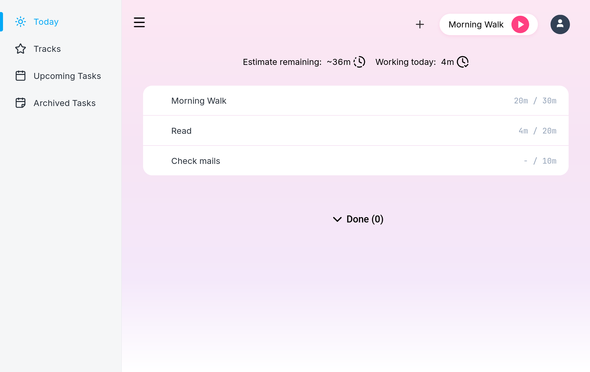

# Build a Habit
A focused habit tracker for people who care about where their hours go. Create habits and track them effectively. Habits may be generated daily or on a weekly basis.



## Features
*   **Flexible Habits:** Set habits to run daily, or specific days of the week.
*   **Time Tracking:** Give any habit a time estimate, then log the actual time spent.
*   **Focus Sessions:** Commit to a duration and run a full-screen timer.
*   **One-off Tasks:** Manage daily errands alongside your habits.

## Local Development

### Prerequisites
*   Node.js
*   MongoDB

### 1. Clone & Install
```bash
git clone https://github.com/adarshrajput181/build-a-habit.git
cd build-a-habit

# Install backend
cd server && npm install

# Install frontend
cd ../react && npm install
```

### 2. Define Environment Variables
The following environment variables have to be defined:
*   MONGODB_URL=your_mongodb_connection_string
*   JWT_SECRET=your_cryptographically_secure_secret
*   NODE_ENV=development (set to production if self-hosting)

### 3. Running Locally
You need to run two servers (run these from repo's root directory):
1. Express Backend
```
cd server
npm run dev
```
2. Vite Frontend
```
cd react
npm run dev
```

## License
The project is licensed under the GPL-3.0 License. See the `LICENSE` file for more details.
